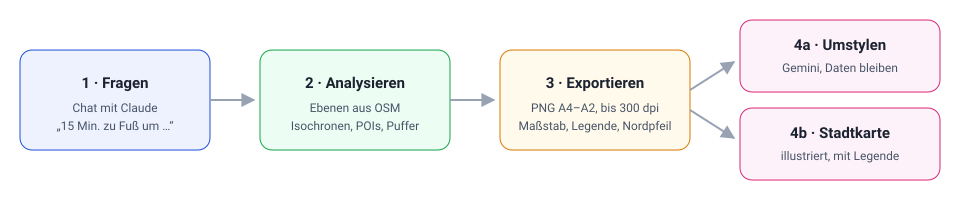

# Kartenwerkstatt

Chat-basierte Standort- und GIS-Analyse mit echten OpenStreetMap-Daten, dazu maßstäblicher Kartenexport und KI-Stylisierung bis hin zur illustrierten Stadtkarte.

Die Idee stammt aus dem Workflow im Video „The Secret to Maps That Are Both Accurate and Stunning“ (Urban Decoders): erst die Daten exakt analysieren, dann den Look mit einem Bildmodell gestalten. Inspiration für die Richtung „Standortanalyse per Chat“ war außerdem [Aino](https://www.aino.world/).



## Was die App kann

| Bereich | Funktion |
|---|---|
| **Chat-Analyse** | Fragen in normaler Sprache, z. B. „15-Minuten-Fußweg um Deventer“. Claude ruft Werkzeuge auf (Ortssuche, Isochronen, OSM-Abfragen, Zuschneiden, Puffer), die Ergebnisse erscheinen als Ebenen auf der Karte. |
| **Ebenen** | Farbe, Deckkraft, Sichtbarkeit und Gruppenfarben je Untertyp ändern, Tabelle mit CSV-Export, Klick auf ein Objekt zeigt Details. Jede Ebene hat eine Kennung (L1, L2, …), über die man sie im Chat ansprechen kann. |
| **Export** | PNG im Format A4, A3 oder A2 (hoch/quer) mit Titel, Maßstabsleiste, Nordpfeil, Legende und Quellenhinweis. Gerendert wird mit bis zu 300 dpi, unabhängig von der Bildschirmauflösung. |
| **Karte umstylen** | Der Exportausschnitt geht mit einem Prompt (Beibehalten / Stil / Inhalte / Platzierung) an Gemini (Nano Banana). Die Daten sollen bleiben, nur der Look ändert sich. Fünf Stilvorlagen. |
| **Illustrierte Stadtkarte** | Gemini zeichnet den Ausschnitt als illustrierte Karte (Aquarell, Vintage, isometrisch, Linienzeichnung). Benannte Punkte, z. B. Sehenswürdigkeiten, werden zu kleinen Zeichnungen. Nummern, Legende und Titel setzt die App selbst, damit die Namen stimmen. |

## Schnellstart

Voraussetzung: Node.js 20 oder neuer.

```bash
npm install
```

```bash
cp .env.example .env
```

Schlüssel in `.env` eintragen (siehe [Konfiguration](#konfiguration)), dann:

```bash
npm start
```

Die App läuft auf http://localhost:3000. Nach jeder Änderung an `.env`, `server.js` oder `lib/` den Server neu starten. Änderungen in `public/` reichen mit Neuladen der Seite.

## Bedienung

### 1. Analyse im Chat

Links ist der Chat. Ein Klick in die Karte markiert einen Punkt, der bei der nächsten Frage mitgeschickt wird. Beispiele:

- „15-Minuten-Fußweg um Deventer, Niederlande“
- „Zeige Grünflächen innerhalb der Isochrone“
- „Haltestellen im 1-km-Radius um den markierten Punkt“
- „Zeige Sehenswürdigkeiten in der Altstadt von Deventer im Umkreis von 700 m um die Brink“
- „Welche Gebäude liegen weiter als 500 m von einem Park entfernt?“
- „Ladesäulen im Umkreis von 2 km“ (beliebige OSM-Tags, hier `amenity=charging_station`)

Fertige Kategorien: ÖPNV-Haltestellen, Grünflächen, Schulen, Kitas, Supermärkte, Gastronomie, Gesundheit, Geschäfte, Fahrrad-Infrastruktur, Parkplätze, Gewässer, Gebäude und Sehenswürdigkeiten.

Eine **Isochrone** ist die Fläche, die man von einem Punkt aus in einer bestimmten Zeit erreicht, berechnet auf dem echten Wegenetz. Deshalb ist sie kein Kreis. Möglich sind zu Fuß (Standard, 15 Minuten), Rad und Auto.

### 2. Ebenen anpassen

Rechts im Tab **Ebenen**: Farbe, Deckkraft, ein-/ausblenden, Tabelle (mit CSV-Export), Zoom, Entfernen. Manuelle Änderungen gehen an den Server zurück, damit der Chat den aktuellen Stand kennt.

### 3. Exportieren

Tab **Export**: Auf der Karte erscheint ein blauer Rahmen, der den Ausschnitt im gewählten Seitenformat zeigt. Mit **×** oder **Esc** lässt er sich ausblenden. Der Export nutzt trotzdem diesen Ausschnitt. Titel, Legende, Maßstabsleiste, Nordpfeil und Quellenhinweis lassen sich einzeln abschalten.

### 4. Karte umstylen

Tab **Stylisieren → Karte umstylen**: Stilvorlage wählen (Planungs-Brief, Dunkel mit Neon, Blue Hour, Historischer Atlas, Gerenderter Lageplan), Felder bei Bedarf anpassen, **Rendern**. „Aus Ebenen übernehmen“ schreibt die sichtbaren Ebenen samt Farben in den Prompt. „Prompt kopieren“ funktioniert auch ohne Key, etwa zum Einfügen in gemini.google.com.

### 5. Illustrierte Stadtkarte

1. Im Chat benannte Punkte holen, am besten Sehenswürdigkeiten.
2. Ausschnitt einstellen. Die Liste im Tab zeigt, welche Orte drinliegen (max. 30, ohne den Standort-Marker).
3. **Stylisieren → Illustrierte Stadtkarte**, Titel und Stil wählen, **Stadtkarte zeichnen**.

Nach etwa 20–30 Sekunden kommt die Karte mit nummerierten Orten und einer Seitenleiste mit Titel und Legende. Der Stil schwankt von Lauf zu Lauf. Zwei Durchläufe und das schönere Bild nehmen ist normal.

## Konfiguration

Alle Einstellungen stehen in `.env` (Vorlage: `.env.example`).

| Variable | Pflicht | Bedeutung |
|---|---|---|
| `ANTHROPIC_API_KEY` | für den Chat | Schlüssel von https://console.anthropic.com |
| `CLAUDE_MODEL` | nein | Modell für den Chat, Standard `claude-sonnet-5-5` |
| `OPENROUTER_API_KEY` | fürs Stylisieren | Schlüssel von https://openrouter.ai/keys |
| `OPENROUTER_IMAGE_MODEL` | nein | Bildmodell, Standard `google/gemini-2.5-flash-image` (Nano Banana). Für höhere Auflösung und bessere Schrift ein Pro-Modell eintragen (kostet mehr). |
| `NOMINATIM_URL`, `VALHALLA_URL`, `OVERPASS_URL` | nein | eigene Instanzen statt der öffentlichen Dienste |
| `PORT` | nein | Standard 3000 |

Fehlt ein Schlüssel, läuft die Oberfläche trotzdem. Die betroffene Funktion ist dann abgeschaltet und zeigt einen Hinweis.

## Datenquellen und Kosten

| Zweck | Dienst | Kosten |
|---|---|---|
| Ortssuche | Nominatim (OSM) | frei, Rate-Limit |
| Isochronen | Valhalla auf valhalla1.openstreetmap.de (FOSSGIS) | frei, Rate-Limit |
| POIs, Flächen, Gebäude | Overpass API (OSM) | frei, Rate-Limit |
| Basiskarte Hell/Dunkel | OpenFreeMap (Vektorkacheln) | frei, ohne Key |
| Basiskarte OpenStreetMap | tile.openstreetmap.org | frei, Nutzungsregeln beachten |
| Chat | Anthropic API (Claude) | nach Verbrauch |
| Stylisieren | OpenRouter → Google Gemini | nach Verbrauch, pro Bild |

Die öffentlichen OSM-Dienste sind für faire Nutzung gedacht. Bei intensiver Nutzung eigene Instanzen eintragen. Exporte enthalten den Quellenhinweis „© OpenStreetMap-Mitwirkende“, der bei Weitergabe stehen bleiben muss.

## Grenzen

- **OSM ist unvollständig.** Zahlen aus der Analyse sind Näherungen, keine amtlichen Werte.
- **Isochronen sind Näherungen** des Wegenetzes. Ampeln, Steigungen und Wartezeiten fließen nur grob ein.
- **Keine Speicherung.** Chat und Ebenen liegen im Arbeitsspeicher. Neuladen der Seite oder Neustart des Servers beginnt eine neue Sitzung.
- **Abfragegrenzen:** Radius max. 5 km, Suchfläche max. 30 km Diagonale, Gebäude max. 1,5 km Radius bzw. 4 km Diagonale, max. 6000 Objekte je Ebene, Isochronen max. 4 Zeiten bis 60 Minuten.
- **Export:** Die Browser-Zeichenfläche ist auf 8192 px begrenzt. A3 erreicht etwa 275 dpi, A2 etwa 195 dpi. Vektorkarten werden scharf, die OSM-Rasterkarte wird nur hochskaliert.
- **Bildmodelle** verfälschen Beschriftungen, Nummern und Lagen. Stylisierte Karten immer gegen das Original prüfen. Die Maßstabsleiste gilt nur für den normalen Export. Nano Banana liefert etwa 1200 px Breite.
- **Illustrierte Stadtkarte:** Gemini setzt nicht an jeden Punkt eine Zeichnung, und manche stehen leicht daneben.

## Fehlerbehebung

| Problem | Ursache und Lösung |
|---|---|
| Chat oder Stylisieren deaktiviert | Schlüssel fehlt in `.env`, oder der Server wurde nach dem Eintragen nicht neu gestartet. |
| „OpenRouter-Fehler 400: Provided image is not valid“ | Das Bild ist zu klein oder leer. Ausschnitt mit sichtbarer Karte wählen. |
| Kein Verbrauch bei OpenRouter | Läuft noch eine alte Server-Version? Neu starten. Fehlermeldungen stehen unter dem Rendern-Knopf. |
| Karte zeigt „API KEY REQUIRED“ | Alte Version mit CARTO-Kacheln im Browser-Cache. Seite neu laden. |
| Overpass antwortet langsam oder mit Fehler | Öffentlicher Dienst ausgelastet. Kurz warten oder kleineres Gebiet abfragen. |

## Entwicklung

```bash
npm test
```

Die Tests laufen ohne Netzwerk, alle externen Dienste sind gemockt. Aufbau, Datenfluss, Schnittstellen und Erweiterungspunkte stehen in [docs/ARCHITEKTUR.md](docs/ARCHITEKTUR.md).

```
server.js          Express-Server, Claude-Agent-Schleife, Stylisieren über OpenRouter
lib/geo.js         Nominatim, Valhalla, Overpass, OSM-Kategorien
lib/tools.js       Werkzeuge des Agenten, Ebenenverwaltung (turf.js)
public/            Oberfläche (MapLibre GL, kein Build-Schritt)
test/              Tests mit gemockten Diensten
docs/              Technische Dokumentation
```
